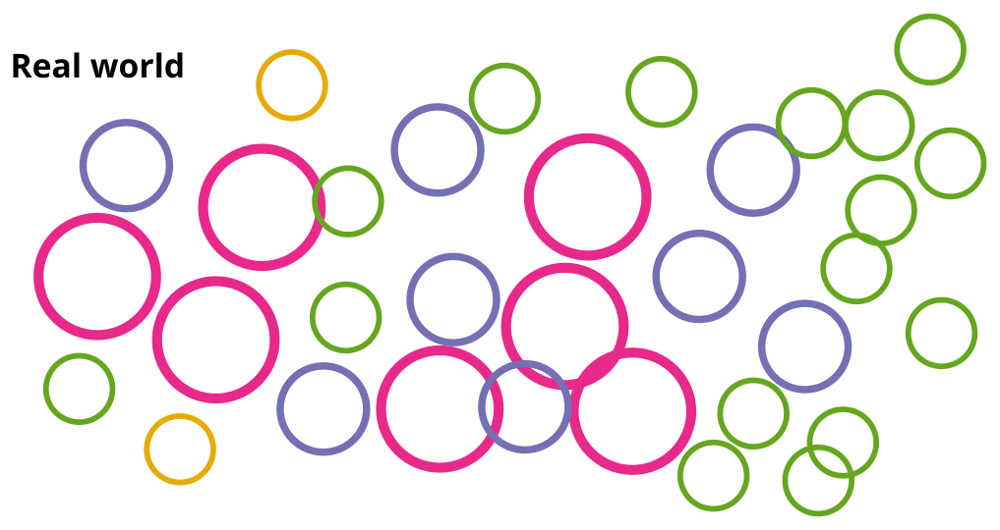
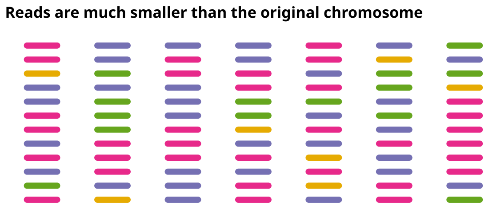
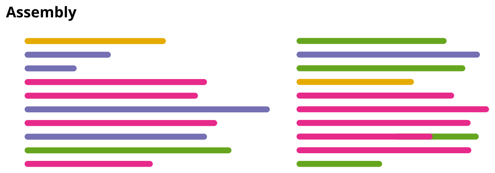
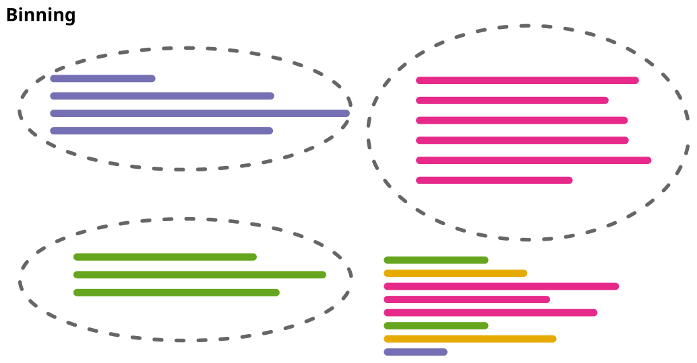
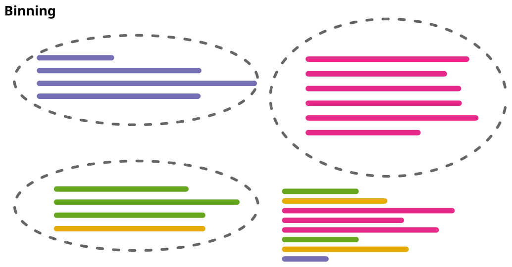
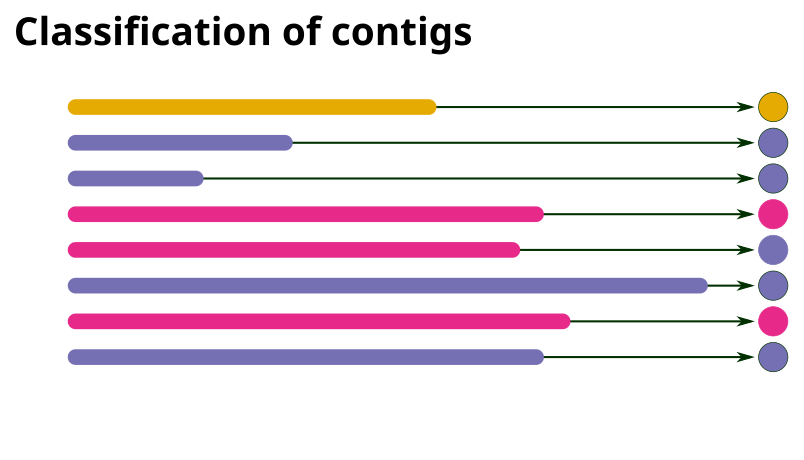
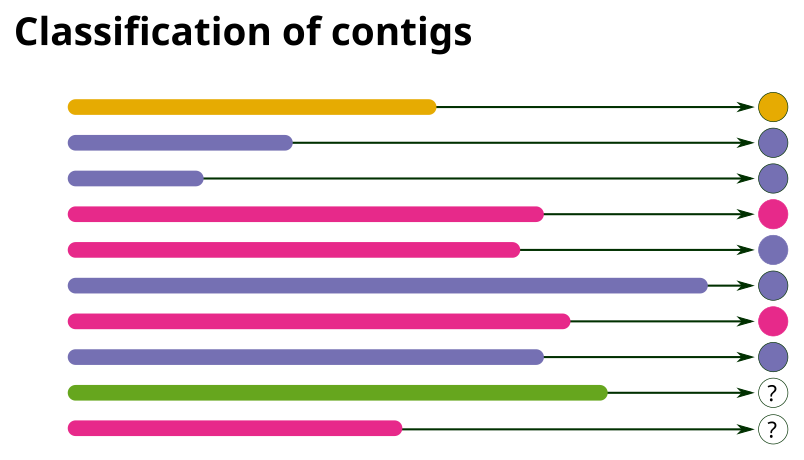
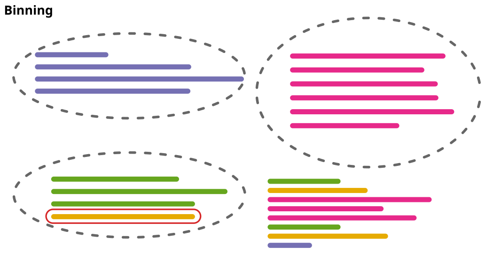
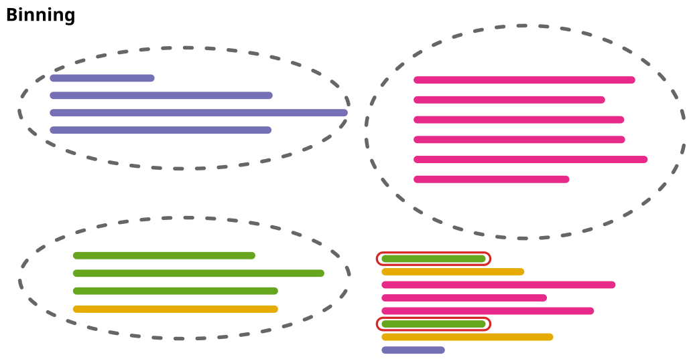
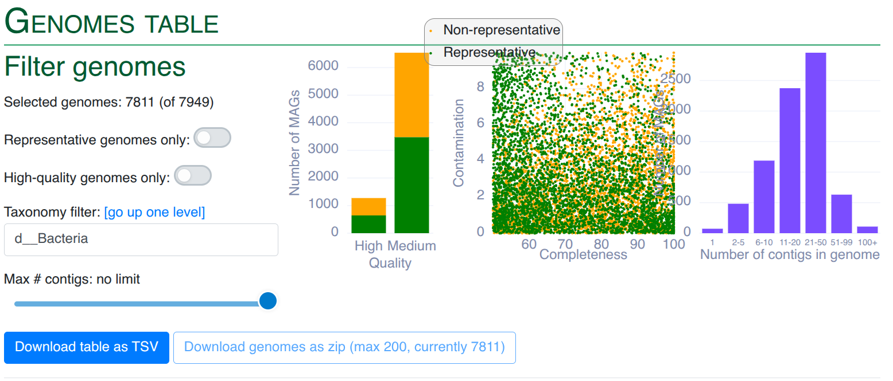

::: handout
These notes have every command of the workshop. The same commands, adapted
to where you are in the workshop, are also available on the workshop machine
through `metag-ws` (see [Your helper: `metag-ws`](#your-helper-metag-ws)).

Feedback, corrections and questions are very welcome: email
<luis@luispedro.org>.
:::

::: instructor
**Draft.** So far this source has the commands of every step and how to use
`metag-ws`. Background slides for each step (what the tool does, why, and how
to read its results) are still to be written: see the TODO notes.

The commands are what `metag-ws show-cmd` prints in a fresh `~/workshop`
with `METAG_WS_THREADS=8`. They come from `metag-ws/metag_ws/steps.toml`:
change them there first, then here.
:::

# Overview

## What we will do

```{.dot width=95%}
digraph pipeline {
  rankdir=LR;
  node [shape=box, style="rounded,filled", fontname="DejaVu Sans", fontsize=11,
        fillcolor="#eceff1", color="#37474f"];
  edge [color="#37474f"];
  data   [label="1. Reads\nshort + long"];
  qc     [label="2. Read QC\nfastp / fastplong"];
  singlem[label="3. Profiling\nSingleM"];
  asm    [label="4. Assembly\nmyloasm"];
  polish [label="5. Polishing\nbwa + polypolish"];
  map    [label="6. Mapping\nbwa + samtools"];
  bin    [label="7. Binning\nSemiBin2"];
  checkm [label="8. CheckM2"];
  gunc   [label="9. GUNC"];
  appr   [label="10. SingleM\nappraise"];
  genes  [label="11. Genes\npyrodigal"];
  egg    [label="12. Annotation\neggNOG-mapper"];
  gtdb   [label="13. Taxonomy\nGTDB-Tk", style="rounded,dashed,filled"];
  mb     [label="14. Binning\nMetaBAT2 + CheckM2"];
  derep  [label="15. Dereplication\nGalah"];
  data -> qc -> singlem;
  qc -> asm -> polish -> map -> bin;
  bin -> checkm; bin -> gunc; bin -> appr; singlem -> appr;
  bin -> genes -> egg;
  bin -> gtdb [style=dashed];
  map -> mb -> derep; bin -> derep; checkm -> derep;
}
```

::: handout
The assembly is based on the long reads (Oxford Nanopore), and the short reads
(Illumina) are used to correct (polish) the assembly and to estimate the
coverage of each contig for binning.

Step 13 (dashed) is too large for the workshop machine: we look at its
results, but do not run it.

Each step names the tools it uses, with links to their papers. [Tools and
references](#tools-and-references), at the end, lists them all, together with
alternatives.
:::

## Learning goals

At the end of the workshop, you should be able to

- read QC reports and decide whether the data are fit for use
- interpret a taxonomic profile, and compare short- and long-read profiles
- go from reads to bins (draft genomes): assembly, polishing, binning
- say which bins are high quality, medium quality or unusable, and why
- find a function of interest in an annotated genome
- read the taxonomic classification of a bin, and tell when it may be a new
  species
- combine the bins of two binners, keeping one genome per species

::: instructor
TODO: a slide or two of background on metagenomics, short vs. long reads,
and what a bin (MAG) is.
:::

## The data

One urban soil sample, sequenced with both Illumina (short reads) and Oxford
Nanopore (long reads):

> Duan Y, Cuscó A, Zhang Y, Inda-Díaz JS, Zhu C, Areias Castro A, Yang X, Yu J,
> Jiang G, Zhao X-M, Coelho LP. *Long-read metagenomic sequencing reveals novel
> lineages and functional diversity in urban soil microbiome.* (2026)
> doi:[10.64898/2026.03.20.713087](https://doi.org/10.64898/2026.03.20.713087)

::: handout
The full sample is ~20 GB of short reads and ~70 GB of long reads. Processing
it takes 38.5 hours (using multiple threads) and >512 GB of RAM.

We use a reduced version (1.2 GB) that keeps the reads of a few genomes that
assemble well, plus a small random fraction of the rest. The commands are
exactly those you would run on the full data, but they finish in minutes!

The price is that the dataset no longer represents the original sample: the
few selected genomes are much more abundant, relative to everything else, than
they were in the soil. **No conclusions about the soil microbiome can be drawn
from this dataset!**
:::

# Working on the workshop machine

## Visual conventions

This workshop contains both conceptual material and hands-on exercises.

A slide that looks like this one is on the conceptual side.

## Visual conventions II: hands-on exercises

A slide that looks like this one is a hands-on exercise: it contains commands to run.

```bash
echo "Hello, world!"
```

You will run the commands on either a virtual machine or on your own laptop.

## Getting started

Log in to the workshop machine, then make your workshop folder and go into it:

```bash
mkdir -p ~/workshop
cd ~/workshop
```

All the tools are already installed, as are the databases they need. Check
that it works:

```bash
metag-ws --help
```

::: instructor
TODO: how participants log in (machine name, user names, passwords or keys),
and how the environment is activated for them (PLAN.md, "The AWS machine").
:::

::: remember
Run all the commands in `~/workshop`. Every path in the commands is relative
to it.
:::

## Your folder

Each step has its own numbered folder:

```{.no-cue}
01_DATA     02_QC        03_SINGLEM   04_ASSEMBLY
05_POLISH   06_MAPPING   07_BINNING   08_CHECKM2
09_GUNC     10_APPRAISE  11_GENES     12_EGGNOG
13_GTDBTK   14_METABAT2  15_DEREP
```

::: handout
Each step writes only into its own folder and reads from the folders of
earlier steps. The numbers make `ls` list them in the order of the workshop.
Substeps (e.g., 2.1 and 2.2, the short- and long-read QC) share their step's
folder.
:::

## Your helper: `metag-ws`

```bash
metag-ws show-cmd
```

```bash
metag-ws explain-cmd
```

```bash
metag-ws results-for
```

::: handout
- `show-cmd` prints the commands of a step, ready to copy and paste.
- `explain-cmd` prints the same commands with every argument explained, and
  what to look at in the results.
- `results-for` brings in our precomputed results, up to the step you choose
  (see the next slide).

Without a step, each of them shows a menu of the steps: the step you used last
is highlighted, and pressing Enter selects the **next** one, so as you go
through the workshop you can mostly just press Enter. Steps you have finished
are marked `done`.

You can also give the step directly: a whole step (`metag-ws show-cmd 5`) or
a substep (`metag-ws show-cmd 5.2`).

The lines starting with `#` in the output of `show-cmd` are comments: they
are harmless if you paste them along with the commands.
:::

## Falling behind? `results-for`

```bash
metag-ws results-for 4
```

- Brings in our results of steps 1 to 4, as `01_DATA_precomputed`, …,
  `04_ASSEMBLY_precomputed`
- Your own folders are never changed
- From then on, `metag-ws show-cmd` uses them as inputs

::: handout
Use it when a step fails, or takes too long, or for any reason at all: you can
then continue from the next step with everyone else.

It always brings in all the steps up to the one you choose, not only that
step. Results from different runs do not mix well: contig names, bin names and
the number of bins differ between runs, so, e.g., our mapping of the reads
would not match your own assembly.

Our results may differ a little from yours, even when you ran exactly the same
commands, for the same reason.
:::

::: remember
After `results-for`, the commands in these notes (which use your own folders)
no longer match: take them from `metag-ws show-cmd` instead.
:::

## Conventions

- The commands use **8 threads** (`-t 8`, `--threads 8`, …): the machine is
  shared, so please do not raise it
- Long commands are split over several lines with `\`: paste the whole block
  at once
- Databases are given by environment variables, already set for you:
  `$CHECKM2DB`, `$GUNC_DB`, `$EGGNOG_DATA_DIR`, `$GTDBTK_DATA_PATH`
  (SingleM finds its own)

::: handout
The slowest steps take several minutes each: SingleM on the long reads (3.2),
assembly (4), GUNC (9) and eggNOG-mapper (12). While they run, read the
explanations (`metag-ws explain-cmd`) or look at the results of the previous
step in a second terminal. Altogether, the commands take about half an hour of
computer time (without step 13, which we do not run).
:::

## Looking at HTML reports

Some tools write their reports as HTML pages (`fastp.html`, the SingleM Krona
charts). Copy them to your laptop and open them in a browser:

```bash
scp USER@WORKSHOP_MACHINE:workshop/02_QC/fastp.html .
```

::: handout
Run this on your laptop, not on the workshop machine, with your user name and
the name of the workshop machine.
:::

::: instructor
TODO: depends on how participants access the machine (SSH, Jupyter, VS Code
remote, ...): with Jupyter or VS Code, they can open the HTML files directly.
:::

# Step 1: Get data

## Copy the reads

```bash
mkdir -p 01_DATA
cp /opt/metag-ws/data/sample_*.fq.gz 01_DATA/
```

- Short reads (Illumina, paired-end): `sample_R1.fq.gz`, `sample_R2.fq.gz`
- Long reads (Oxford Nanopore): `sample_ont.fq.gz`

## Look at the reads

```bash
zcat 01_DATA/sample_R1.fq.gz | head -8
```

```bash
seqkit stats 01_DATA/*.fq.gz
```

::: handout
Tool: [SeqKit](https://bioinf.shenwei.me/seqkit/)
([Shen et al., 2016](https://doi.org/10.1371/journal.pone.0163962);
[Shen et al., 2024](https://doi.org/10.1002/imt2.191)).
:::

::: instructor
TODO: FASTQ format; how many reads and bases of each kind; read lengths.
:::

# Step 2: Read quality control

## 2.1: Short reads (fastp)

```bash
mkdir -p 02_QC
fastp \
    -i 01_DATA/sample_R1.fq.gz -I 01_DATA/sample_R2.fq.gz \
    -o 02_QC/sr_R1.fq.gz -O 02_QC/sr_R2.fq.gz \
    -h 02_QC/fastp.html -j 02_QC/fastp.json \
    -w 8
```

Look at `02_QC/fastp.html`:

- How many reads and bases passed the filters?
- Quality per position (before and after filtering), adapter content,
  duplication rate, insert size

::: handout
Tool: [fastp](https://github.com/OpenGene/fastp)
([Chen et al., 2018](https://doi.org/10.1093/bioinformatics/bty560);
[Chen, 2023](https://doi.org/10.1002/imt2.107)).
:::

## 2.2: Long reads (fastplong)

```bash
mkdir -p 02_QC
fastplong \
    -i 01_DATA/sample_ont.fq.gz -o 02_QC/lr.fq.gz \
    -l 1000 \
    -h 02_QC/fastplong.html -j 02_QC/fastplong.json \
    -w 8
```

Look at `02_QC/fastplong.html`:

- Read length distribution (and N50), read quality
- How many reads and bases were removed?
- Compare the number of bases with the short reads

::: handout
Tool: [fastplong](https://github.com/OpenGene/fastplong), the long-read
version of fastp. It has no paper of its own: its authors ask that you cite
fastp.
:::

::: instructor
TODO: background on fastp/fastplong and how to decide whether the data are
fit for use.
:::

# Step 3: Read-based taxonomic profiling (SingleM)

## 3.1: Short reads

```bash
mkdir -p 03_SINGLEM
singlem pipe \
    -1 02_QC/sr_R1.fq.gz -2 02_QC/sr_R2.fq.gz \
    --otu-table 03_SINGLEM/sr.otu.tsv \
    -p 03_SINGLEM/sr.profile.tsv \
    --taxonomic-profile-krona 03_SINGLEM/sr.profile.html \
    --threads 8
```

Look at `03_SINGLEM/sr.profile.html` (Krona: click to zoom in):

- Which phyla and genera dominate?
- How much is classified only at a high level (e.g., phylum)?

::: handout
`03_SINGLEM/sr.profile.tsv` has the same profile as a table (coverage per
taxon).

Tool: [SingleM](https://wwood.github.io/singlem/)
([Woodcroft et al., 2025](https://doi.org/10.1038/s41587-025-02738-1)). The
taxonomy is that of [GTDB](https://gtdb.ecogenomic.org)
([Parks et al., 2025](https://doi.org/10.1093/nar/gkaf1040)), and the charts
are drawn with [Krona](https://github.com/marbl/Krona)
([Ondov et al., 2011](https://doi.org/10.1186/1471-2105-12-385)).
:::

## 3.2: Long reads

```bash
mkdir -p 03_SINGLEM
singlem pipe \
    -1 02_QC/lr.fq.gz \
    --otu-table 03_SINGLEM/lr.otu.tsv \
    -p 03_SINGLEM/lr.profile.tsv \
    --taxonomic-profile-krona 03_SINGLEM/lr.profile.html \
    --threads 8
```

Compare the long-read profile, `03_SINGLEM/lr.profile.html`, with the
short-read one, `03_SINGLEM/sr.profile.html`:

- Do the two technologies see the same taxa, in similar proportions?
- Which differences could come from the technology, and which from the amount
  of data?

::: instructor
TODO: background on SingleM (marker genes, OTU tables, GTDB), and why a
read-based profile sees organisms that assembly misses.
:::

# Long vs. short reads

- Long reads are long, but each base pair has lower quality
- Short reads can be used to fix these errors, termed _polishing_

# How to assemble?

Different options

1. Assemble long reads, use short reads to polish assembly
2. Assemble short reads, use long reads to scaffold
3. Polish long reads, assemble the polished long reads
4. Hybrid assemblers

The term _hybrid assembly_ is sometimes used to refer specifically to using a
specialised hybrid assembler or for the general concept of using long and short
reads.

# Step 4: Long-read assembly (myloasm)

## Assemble the long reads

```bash
myloasm 02_QC/lr.fq.gz -o 04_ASSEMBLY -t 8
```

::: handout
`myloasm` creates the folder `04_ASSEMBLY` itself. Only the long reads are
used for assembly; the short reads come in at the next step.

Tool: [myloasm](https://github.com/bluenote-1577/myloasm)
([Shaw et al., 2026](https://doi.org/10.1038/s41587-026-03053-z)).
:::

## Look at the assembly

The contigs are in `04_ASSEMBLY/assembly_primary.fa`. Their number and
lengths:

```bash
seqkit stats -a 04_ASSEMBLY/assembly_primary.fa
```

The contig names say whether a contig is circular (a complete chromosome or
plasmid?) and its depth:

```bash
grep -c circular-yes 04_ASSEMBLY/assembly_primary.fa
```

::: instructor
TODO: background on long-read metagenome assembly; N50; what circular
contigs mean.
:::

# Step 5: Polishing with short reads

## 5.1: Map the short reads to the draft

Index the draft assembly:

```bash
mkdir -p 05_POLISH
bwa index -p 05_POLISH/draft 04_ASSEMBLY/assembly_primary.fa
```

Map each read end separately, keeping all alignments (`-a`):

```bash
bwa mem -t 8 -a 05_POLISH/draft 02_QC/sr_R1.fq.gz > 05_POLISH/aln_R1.sam
bwa mem -t 8 -a 05_POLISH/draft 02_QC/sr_R2.fq.gz > 05_POLISH/aln_R2.sam
```

::: handout
Tool: [BWA](https://github.com/lh3/bwa) (`bwa mem`;
[Li & Durbin, 2009](https://doi.org/10.1093/bioinformatics/btp324);
[Li, 2013](https://arxiv.org/abs/1303.3997)).
:::

## Look at the alignments

SAM files are text:

```bash
grep -v '^@' 05_POLISH/aln_R1.sam | head
```

With `-a`, a read can have several alignments (flag 256 = secondary).

## 5.2: Polish (polypolish)

Filter the alignments, using the read pairs:

```bash
mkdir -p 05_POLISH
polypolish filter \
    --in1 05_POLISH/aln_R1.sam --in2 05_POLISH/aln_R2.sam \
    --out1 05_POLISH/filtered_R1.sam --out2 05_POLISH/filtered_R2.sam
```

Polish:

```bash
polypolish polish 04_ASSEMBLY/assembly_primary.fa \
    05_POLISH/filtered_R1.sam 05_POLISH/filtered_R2.sam > 05_POLISH/polished.fa
```

::: handout
polypolish reports (on the screen) how many positions it changed. Few changes
mean that the long-read assembly was already accurate. The polished assembly,
`05_POLISH/polished.fa`, has the same contigs, with corrected bases.

Generally, expect a relatively small number of changes, but they can have a
large effect on the predicted proteins especially if they fix frameshifts.

Tool: [Polypolish](https://github.com/rrwick/Polypolish)
([Wick & Holt, 2022](https://doi.org/10.1371/journal.pcbi.1009802);
`polypolish filter`: [Bouras et al., 2024](https://doi.org/10.1099/mgen.0.001254)).
:::

::: instructor
TODO: why polish (error profile of Nanopore reads), and why polypolish needs
all alignments (repeats).
:::

# Step 6: Map reads to the polished assembly

## Map the short reads, as pairs

```bash
mkdir -p 06_MAPPING
bwa index -p 06_MAPPING/polished 05_POLISH/polished.fa
```

```bash
bwa mem -t 8 06_MAPPING/polished 02_QC/sr_R1.fq.gz 02_QC/sr_R2.fq.gz \
    | samtools sort -@ 8 -o 06_MAPPING/sr.sorted.bam
```

```bash
samtools index 06_MAPPING/sr.sorted.bam
```

::: handout
Tools: [BWA](https://github.com/lh3/bwa) (as in step 5) and
[SAMtools](https://www.htslib.org)
([Danecek et al., 2021](https://doi.org/10.1093/gigascience/giab008)).
:::

## Look at the mapping

What fraction of the reads maps to the assembly?

```bash
samtools flagstat 06_MAPPING/sr.sorted.bam
```

Coverage per contig:

```bash
samtools coverage 06_MAPPING/sr.sorted.bam | head
```

::: handout
Reads that do not map come from organisms (or parts of genomes) that were not
assembled.
:::

# Step 7: Binning (SemiBin2)

## The metagenomics binning problem

::: slides
:::: r-stack
::::: {.fragment .fade-out data-fragment-index="1"}

:::::
::::: {.fragment .fade-in-then-out data-fragment-index="1"}

:::::
::::: {.fragment .fade-in-then-out data-fragment-index="2"}

:::::
::::: {.fragment .fade-in-then-out data-fragment-index="3"}

:::::
::::: {.fragment .fade-in data-fragment-index="4"}

:::::
::::

::::: {.fragment data-fragment-index="4"}
Bins can be wrong: a yellow contig in the green bin is *contamination*
(Step 8).
:::::
:::

::: handout
{width="55%"}

A sample contains many organisms, each with its own genome. Sequencing
breaks these genomes into reads that are much shorter than the genomes, and
the reads of all organisms are mixed together. Assembly joins the reads back
into *contigs*, but rarely into complete chromosomes: we get many contigs per
genome, and nothing says which contig came from which organism. *Binning*
groups the contigs into *bins*, each meant to be one genome (a *MAG*,
metagenome-assembled genome). Some contigs stay unbinned, and bins can be
wrong: a bin with contigs from another organism is *contaminated* (Step 8).
:::

## Binning is a clustering problem

- We have a set of contigs
- We want to group them into bins, one per genome

::: fragment
Contigs from the same genome look alike in

- **abundance**: they have similar coverage (here, from the mapping of Step 6)
- **_k_-mer composition**: each genome has its own frequencies of short words
:::

::: fragment
**_k_-mers** of `ATGTGCTAG`, for _k_ = 4:
[`ATGT` `TGTG` `GTGC` `TGCT` `GCTA` `CTAG`]{.tokens}

Count how often each _k_-mer appears in each contig.
:::

## We can also classify contigs

::: slides
:::: r-stack
::::: {.fragment .fade-out data-fragment-index="1"}

:::::
::::: {.fragment .fade-in data-fragment-index="1"}

:::::
::::

:::: fragment
Classifying against a reference database makes errors, and in a typical
metagenome **most** contigs cannot be classified at all.
::::
:::

::: handout
An alternative to binning is to classify each contig taxonomically by
comparing it to a reference database. Classification makes mistakes, and it
only works for organisms that are close to something in the database: in
most environments (soil in particular) the majority of contigs stay
unclassified. Binning needs no reference, so it can recover genomes of
organisms that have never been seen before.
:::

## What SemiBin2 does

- Represents each contig by its _k_-mer composition and its abundance
- Learns a transformation (an *embedding*) in which contigs that should go
  together are close, using *contrastive learning*:
  - two fragments of the same contig should end up together (*must-link*)
  - two contigs picked at random most likely should not (*cannot-link*)
- Clusters the contigs in the embedded space

::: fragment
Learning the embedding is slow: `--environment soil` instead uses a model
already trained on soil samples.
:::

::: handout
SemiBin2 is *self-supervised*: the pairs it learns from are generated from
the data itself, with no reference database. Random pairs of contigs are
occasionally from the same genome, but rarely enough that learning still
works. Pretrained models are available for several environments (human gut,
ocean, soil, ...); one trained on similar samples works nearly as well as one
trained on yours.
:::

## Bin the contigs

```bash
SemiBin2 single_easy_bin \
    -i 05_POLISH/polished.fa \
    -b 06_MAPPING/sr.sorted.bam \
    --environment soil \
    --sequencing-type long_read \
    --compression none \
    -o 07_BINNING \
    -t 8
```

::: handout
`--environment soil` uses a model pretrained on soil samples instead of
training one on this sample, which would be slower.

Tool: [SemiBin2](https://github.com/BigDataBiology/SemiBin)
([Pan et al., 2023](https://doi.org/10.1093/bioinformatics/btad209)).
:::

## Look at the bins

Each bin is a FASTA file in `07_BINNING/output_bins/`.

- How many bins are there, and how large are they?
- `07_BINNING/bins_info.tsv`: size, number of contigs, N50

```bash
seqkit stats 07_BINNING/output_bins/*.fa
```

::: instructor
Background on binning is in the slides before *Bin the contigs*: the problem,
the features (composition + coverage), classification vs. binning, and what
SemiBin2 does.
:::

# Step 8: Completeness and contamination (CheckM2)

## How can a bin be wrong?

::: slides
:::: r-stack
::::: {.fragment .fade-out data-fragment-index="1"}
{height="400"}
:::::
::::: {.fragment .fade-in-then-out data-fragment-index="1"}
{height="400"}
:::::
::::: {.fragment .fade-in data-fragment-index="2"}
{height="400"}
:::::
::::

::::: {.fragment data-fragment-index="1"}
**Contamination** (false positive): contigs that do not belong in the bin
:::::
::::: {.fragment data-fragment-index="2"}
**Incompleteness** (false negative): contigs missing from the bin
:::::
:::

::: handout
{width="55%"}

Binning makes two kinds of errors (see the figures in Step 7). A bin is
*contaminated* when it has contigs that do not belong there (false
positives), such as the yellow contig in the green bin. It is *incomplete*
when contigs of its genome were left out (false negatives), such as the
green contigs that stayed unbinned. Both are measured as percentages of a
genome; but we do not know the genome, so how can we measure them?
:::

## Single-copy marker genes

- Genes for the basic machinery of life: ribosomal proteins, tRNA
  synthetases, RNA polymerase, ...
- Found in (nearly) every bacterial and archaeal genome
- ... and only **once** per genome (mostly)

::: fragment
Count them in a bin, and we can tell how much of a genome the bin has, and
whether it has more than one.
:::

::: handout
Many sets of such genes have been proposed, for example the 31 universal
genes of [Ciccarelli et al., 2006](https://doi.org/10.1126/science.1123061).
They are the genes used to build the tree of life, and SingleM (Step 3)
profiles a sample from the reads that come from them.
:::

## CheckM1: counting marker genes

::: slides
:::: r-stack
::::: {.fragment .fade-out data-fragment-index="1"}

:::::
::::: {.fragment .fade-in-then-out data-fragment-index="1"}

:::::
::::: {.fragment .fade-in-then-out data-fragment-index="2"}

:::::
::::: {.fragment .fade-in data-fragment-index="3"}

:::::
::::

A good genome has **all** the marker genes, and **none** of them twice.
:::

::: handout
{width="65%"}

CheckM ([Parks et al., 2015](https://doi.org/10.1101/gr.186072.114)) looks
for single-copy marker genes in each bin. A good genome has all of them, and
none twice:

- **completeness** is the fraction of the marker genes found in the bin,
- **contamination** is the number of extra copies, as a fraction of the
  number of marker genes. It can be more than 100%: a bin that mixes three
  complete genomes has two extra copies of each marker, 200% contamination.

CheckM1 picks the marker genes for each bin from its place in a reference
tree (genes that are single-copy in its lineage), and counts genes that are
found next to each other on genomes as a set, so that a single lost contig
does not count many times.
:::

::: instructor
Step through the figure: before showing the counts of each bin, ask the room
for its completeness and contamination.
:::

## CheckM2: genes come in groups

::: slides
:::: r-stack
::::: {.fragment .fade-out data-fragment-index="1"}

:::::
::::: {.fragment .fade-in-then-out data-fragment-index="1"}

:::::
::::: {.fragment .fade-in data-fragment-index="2"}

:::::
::::

Genes form groups (pathways, complexes): seeing B1 and B3, expect B2.
CheckM2 *learns* these from reference genomes (machine learning).
:::

::: handout
{width="65%"}

CheckM2 ([Chklovski et al., 2023](https://doi.org/10.1038/s41592-023-01940-w))
looks at all the genes of a bin, not only at universal marker genes.

The system is machine learning based, so it is hard to know what it truly does,
but a simple intuition is that, beyond single-copy markers, genes form groups
(the enzymes of a pathway, the subunits of a complex), so seeing some genes of
a group means the others should be there too: a bin with B1 and B3 but no B2 is
probably missing a contig. A bin with no gene of a group at all is not, though:
that organism just does not have that pathway.

Its models were trained on reference genomes from which contigs were removed
(incompleteness) or to which contigs of other genomes were added
(contamination), so that the true answer was known.

:::

::: instructor
A note that the system is not perfect: CheckM2 always reports low completeness
for *Allobaculum*, and likely others.
:::

## Run CheckM2

```bash
checkm2 predict \
    -i 07_BINNING/output_bins -x fa \
    -o 08_CHECKM2 \
    --database_path $CHECKM2DB \
    -t 8 --force
```

::: handout
Tool: [CheckM2](https://github.com/chklovski/CheckM2)
([Chklovski et al., 2023](https://doi.org/10.1038/s41592-023-01940-w)).
:::

## Look at the quality report

`08_CHECKM2/quality_report.tsv`: completeness and contamination of each bin.

```bash
sort -t$'\t' -k2,2gr 08_CHECKM2/quality_report.tsv | cut -f1-3 | column -t
```

Common thresholds (MIMAG):

- **high quality**: >90% complete, <5% contaminated
- **medium quality**: ≥50% complete, <10% contaminated

Which of your bins are high quality?

::: handout
MIMAG is a community standard for reporting MAGs
([Bowers et al., 2017](https://doi.org/10.1038/nbt.3893)).
:::

# Step 9: Chimerism (GUNC)

## GUNC: do the taxa follow the contigs?

::: slides
:::: r-stack
::::: {.fragment .fade-out data-fragment-index="1"}

:::::
::::: {.fragment .fade-in data-fragment-index="1"}

:::::
::::

Classify each gene to a taxon: the classifier makes mistakes, but *where*
they are tells noise from a chimera.
:::

::: handout
{width="65%"}

GUNC ([Orakov et al., 2021](https://doi.org/10.1186/s13059-021-02393-0))
classifies every gene of a bin to a taxon. If classifiers were perfect, a clean
bin would have only one taxon, and a chimera would have more than one. In fact,
if classifiers were perfect, we would not need binning at all!

Classifiers make mistakes because the reference databases are incomplete, but
GUNC uses the pattern of the mistakes to distinguish a clean bin from a chimera.

In particular, GUNC looks at how the taxa classifications
are spread over the contigs. In a chimera, the taxonomic classifications of
genes should follow the contig boundaries (not perfectly, but better than
random). In a clean genome, the errors will be scattered across the contigs.

The *clade separation score* (CSS) measures this, at every taxonomic level: how
well the contigs separate the taxa, compared to what would be expected by
chance. How the intuition was turned into a mathematical score is explained in
a [blog post](https://www.big-data-biology.org/blog/2021/02/12/gunc/).

GUNC is intended to complement CheckM2, not replace it.
:::

::: instructor
Step through the figure: before showing the second bin, ask the room whether
the first is contaminated. Both bins have exactly the same genes and the same
taxa; only where the B genes are changes.
:::

## Run GUNC

```bash
mkdir -p 09_GUNC
gunc run \
    -d 07_BINNING/output_bins -e .fa \
    -r $GUNC_DB \
    -o 09_GUNC --temp_dir 09_GUNC \
    -t 8
```

::: handout
Tool: [GUNC](https://grp-bork.embl-community.io/gunc/)
([Orakov et al., 2021](https://doi.org/10.1186/s13059-021-02393-0)), with its
database built from [proGenomes 2.1](https://progenomes.embl.de)
([Mende et al., 2020](https://doi.org/10.1093/nar/gkz1002)).
:::

## Look at the GUNC results

```bash
cut -f1,2,8,9,13 09_GUNC/GUNC.progenomes_2.1.maxCSS_level.tsv | column -t
```

- `pass.GUNC`: whether the bin passes
- `clade_separation_score` (CSS) above 0.45: genes from different lineages
  were mixed (a chimera)

Do the bins that CheckM2 calls high quality pass GUNC?

# Step 10: What did the bins capture? (SingleM appraise)

## Marker genes in the bins

```bash
mkdir -p 10_APPRAISE
singlem pipe \
    --genome-fasta-files 07_BINNING/output_bins/*.fa \
    --otu-table 10_APPRAISE/bins.otu.tsv \
    -p 10_APPRAISE/bins.profile.tsv \
    --threads 8
```

::: handout
Tool: [SingleM](https://wwood.github.io/singlem/) again (`pipe` and
`appraise`; [Woodcroft et al., 2025](https://doi.org/10.1038/s41587-025-02738-1)).
:::

## Compare reads and bins

```bash
singlem appraise \
    --metagenome-otu-tables 03_SINGLEM/sr.otu.tsv \
    --genome-otu-tables 10_APPRAISE/bins.otu.tsv \
    --output-unaccounted-for-otu-table 10_APPRAISE/appraise_sr.unaccounted.tsv \
    > 10_APPRAISE/appraise_sr.txt
singlem appraise \
    --metagenome-otu-tables 03_SINGLEM/lr.otu.tsv \
    --genome-otu-tables 10_APPRAISE/bins.otu.tsv \
    --output-unaccounted-for-otu-table 10_APPRAISE/appraise_lr.unaccounted.tsv \
    > 10_APPRAISE/appraise_lr.txt
```

## Look at the appraisal {.handson}

- `10_APPRAISE/appraise_sr.txt`: `percent_binned` is the fraction of the
  marker-gene coverage in the reads that is in the bins
- `10_APPRAISE/appraise_sr.unaccounted.tsv`: what is in the reads but in no
  bin. Which taxa are missing, and why (abundance)?
- Compare with the long reads (`appraise_lr.*`)

# Step 11: Gene prediction (pyrodigal)

## Functional annotation, in three steps

::: slides
:::: r-stack
::::: {.fragment .fade-out data-fragment-index="1"}

:::::
::::: {.fragment .fade-in-then-out data-fragment-index="1"}

:::::
::::: {.fragment .fade-in data-fragment-index="2"}

:::::
::::
:::

::: handout
{width="65%"}

Annotating the functions of a MAG takes three steps:

1. **Predict the genes** (open reading frames, ORFs) on the contigs, with
   Prodigal or Pyrodigal (this step).
2. **Annotate the genes**, by comparing them to a database of genes whose
   function is known. eggNOG-mapper (Step 12) is generic; other tools are
   specialised, such as RGI for antibiotic resistance genes, with its own
   database (CARD).
3. **Use informed human judgement.** Every tool reports some hits that are
   wrong: matches just above (or, if you ask for them, below) a threshold, or
   genes out of context, such as a regulator found without the genes it
   regulates. Filter the annotations before drawing conclusions from them.
:::

## Predict genes in each bin

```bash
mkdir -p 11_GENES
for fa in 07_BINNING/output_bins/*.fa; do
    b=$(basename $fa .fa)
    pyrodigal -i $fa -a 11_GENES/$b.faa -d 11_GENES/$b.fna -o 11_GENES/$b.gff
done
```

::: handout
A shell loop: the commands inside run once per bin. For each bin `BIN`, the
outputs are `11_GENES/BIN.faa` (proteins), `BIN.fna` (genes, DNA) and
`BIN.gff` (coordinates).

Tool: [Pyrodigal](https://github.com/althonos/pyrodigal)
([Larralde, 2022](https://doi.org/10.21105/joss.04296)), Python bindings to
[Prodigal](https://github.com/hyattpd/Prodigal)
([Hyatt et al., 2010](https://doi.org/10.1186/1471-2105-11-119)).
:::

## Look at the genes

How many genes per bin?

```bash
grep -c '>' 11_GENES/*.faa
```

Do larger bins have more genes? About how many genes per Mbp?

# Step 12: Functional annotation (eggNOG-mapper)

## Annotate one bin

Annotating all bins takes too long, so we annotate one: the first command
picks the best bin in `08_CHECKM2/quality_report.tsv` (highest completeness −
5 × contamination).

```bash
BIN_NAME=$(awk -F'\t' 'NR > 1 { print $2 - 5 * $3, $1 }' 08_CHECKM2/quality_report.tsv \
    | sort -gr | head -n 1 | cut -d' ' -f2)
echo $BIN_NAME
mkdir -p 12_EGGNOG
pixi run -e eggnog emapper.py \
    -i 11_GENES/$BIN_NAME.faa --itype proteins \
    -m diamond \
    --data_dir $EGGNOG_DATA_DIR \
    -o $BIN_NAME --output_dir 12_EGGNOG \
    --temp_dir 12_EGGNOG \
    --cpu 8 --override
```

To annotate another bin, set the variable yourself instead, e.g.
`BIN_NAME=SemiBin_2`.

::: handout
`BIN_NAME=...` sets a shell variable; `$BIN_NAME` uses it. `$(...)` runs a
command and uses its output: here, `awk` computes the score of each bin,
`sort -gr` puts the highest first, and `head`/`cut` keep the name of the top
one. Shell variables are lost when you close the terminal: if you open a new
one, set `BIN_NAME` again before looking at the annotations.

eggNOG-mapper is installed in its own environment (`eggnog`), because it
needs a different version of one of its dependencies (DIAMOND) than GUNC.
`pixi run -e eggnog` runs a command in that environment.

Tool: [eggNOG-mapper](https://github.com/eggnogdb/eggnog-mapper)
([Cantalapiedra et al., 2021](https://doi.org/10.1093/molbev/msab293)), with the
[eggNOG 5](http://eggnog5.embl.de) database
([Huerta-Cepas et al., 2019](https://doi.org/10.1093/nar/gky1085)) and
[DIAMOND](https://github.com/bbuchfink/diamond)
([Buchfink et al., 2021](https://doi.org/10.1038/s41592-021-01101-x)).
:::

## Look at the annotations

`12_EGGNOG/$BIN_NAME.emapper.annotations`: one line per protein, with its gene
name (`Preferred_name`), description, COG category, KEGG orthologs and
pathways, CAZy families, …

Look for a function:

```bash
grep -i nitrogenase 12_EGGNOG/$BIN_NAME.emapper.annotations | cut -f1,8,9
```

- How many proteins have an annotation?
- Which COG categories are the most common?

::: instructor
TODO: background on orthology-based annotation, and an exercise looking for
a function across bins.
:::

## What about small proteins? {.lecture}

- Proteins shorter than 100 amino acids were traditionally ignored: gene
  predictors miss most of them, and databases have few
- Catalogs of them now exist, such as the
  [Global Microbial smORF Catalogue (GMSC)](https://gmsc.big-data-biology.org/):
  ~965 million small ORFs (smORFs) from 63,410 metagenomes and 87,920 genomes
- [GMSC-mapper](https://github.com/BigDataBiology/GMSC-mapper) finds and
  annotates them in your own contigs or bins

```{.dot width=95%}
digraph gmsc_mapper {
  rankdir=LR;
  node [shape=box, style="rounded,filled", fontname="DejaVu Sans", fontsize=11,
        fillcolor="#eceff1", color="#37474f"];
  edge [color="#37474f"];
  contigs [label="Contigs\nor bins"];
  predict [label="Predict smORFs\npyrodigal"];
  search  [label="Search GMSC\nDIAMOND or MMseqs2"];
  annot   [label="Annotate\ntaxonomy, habitat,\ndomains, quality"];
  contigs -> predict -> search -> annot;
}
```

::: handout
Small ORFs (smORFs, encoding fewer than 100 amino acids) are hard to predict:
any random stretch of DNA contains many short ORFs, so gene predictors such as
Prodigal (step 11) are tuned to skip most of them, and few have a known
function. Yet some are real, conserved genes (for example, antimicrobial
peptides and toxins). Large-scale studies of microbiomes, first in the human
gut ([Sberro et al., 2019](https://doi.org/10.1016/j.cell.2019.07.016)) and
then across habitats, have started to catalogue them.

The [Global Microbial smORF Catalogue](https://gmsc.big-data-biology.org/)
(GMSC; [Duan et al., 2024](https://doi.org/10.1038/s41467-024-51894-6)) holds
~965 million non-redundant smORFs, from 63,410 public metagenomes and 87,920
genomes, clustered into ~288 million families (at 90% amino acid identity).
Each is annotated with its taxonomy, the habitats where it is found, conserved
domains, cellular localisation and quality (evidence that it is a real gene).

GMSC-mapper predicts the smORFs in your contigs (or bins), searches them
against GMSC, and transfers these annotations. A single smORF can also be
looked up on the GMSC website.
:::

# Step 13: Taxonomy of the bins (GTDB-Tk)

## Classify the bins (not run here)

::: reference
The command, **not to run**: GTDB-Tk needs about 130 GB of memory and takes
about 40 minutes (with 16 threads).

```{.bash .no-cue}
mkdir -p 13_GTDBTK
pixi run -e gtdbtk gtdbtk classify_wf \
    --genome_dir 07_BINNING/output_bins -x fa \
    --out_dir 13_GTDBTK \
    --cpus 8
```
:::

Instead, bring in our results:

```bash
metag-ws results-for 13
```

::: handout
GTDB-Tk is the standard way to give a bin its place in the GTDB taxonomy (the
one SingleM uses in steps 3 and 10)

It finds 120 bacterial (or 53 archaeal) single-copy marker genes in each bin,
then:

1. compares the bin with the GTDB species representatives (average
   nucleotide identity, ANI, with skani): a bin within the ANI radius of a
   species (usually 95%) is assigned to it;
2. otherwise, places the bin in the GTDB tree using the aligned marker genes
   (pplacer), and takes the taxonomy of where it lands, using relative
   evolutionary divergence (RED) to decide the rank (genus, family, …).

`results-for 13` brings in all our results (steps 1 to 13), so that you can
compare the classification with our CheckM2 and SingleM results for the same
bins. Unlike for the other steps, it does not change which inputs the
commands of `metag-ws show-cmd` use.

GTDB-Tk is in its own environment (`gtdbtk`), like eggNOG-mapper in step 12.

Tool: [GTDB-Tk](https://github.com/Ecogenomics/GTDBTk)
([Chaumeil et al., 2022](https://doi.org/10.1093/bioinformatics/btac672)),
with [GTDB](https://gtdb.ecogenomic.org) release 232,
[skani](https://github.com/bluenote-1577/skani)
([Shaw and Yu, 2023](https://doi.org/10.1038/s41592-023-02018-3)) and
[pplacer](https://github.com/matsen/pplacer)
([Matsen et al., 2010](https://doi.org/10.1186/1471-2105-11-538)).
:::

## Look at the classification

```bash
cut -f1,2,6,14 13_GTDBTK_precomputed/gtdbtk.bac120.summary.tsv | column -t -s$'\t'
```

- `classification`: domain to species (`d__…;p__…;…;s__…`)
- `closest_genome_ani`: ANI to the closest species representative
- `classification_method`: by ANI, or by placement in the tree

Archaea, if any, are in `gtdbtk.ar53.summary.tsv`.

- Which bins have a species (`s__` followed by a name)? Those without one may
  be new species
- Bins with too few marker genes are `Unclassified`: how complete are they
  (`08_CHECKM2_precomputed/quality_report.tsv`)?
- Does SingleM agree (`10_APPRAISE_precomputed/bins.profile.tsv`)?

::: instructor
Our results (precomputed run, 31 bins; 40 min, 128 GB peak, almost all of
it pplacer):

- The five high-quality bins: SemiBin_0, SemiBin_1 and SemiBin_3 are known
  GTDB species (ANI 99.5%, 99.9% and 98.5%, by the ANI screen). SemiBin_2
  (the bin annotated in step 12; *Cyclobacteriaceae*, genus ZC4RG29) and
  SemiBin_4 (*Steroidobacteraceae*, genus RPQJ01) have no species: placed in
  the tree, not within 95% ANI of any species representative, so possibly
  new species. SingleM agrees on SemiBin_2 down to the genus.
- Several partial *Nitrospira_C* bins (SemiBin_7, 10, 26, 27, 28) without a
  species, and SemiBin_22 (25% complete) only to the family (`g__` empty,
  decided by RED).
- 18 small bins (mostly <15% complete, <1 Mbp) are `Unclassified Bacteria`:
  too few marker genes to place them.

"No species" in GTDB means no species representative within its ANI radius,
not that the organism was never seen: it may be in a newer release, or in
genomes that are not in GTDB. GTDB-Tk itself warns that its classification
is not enough to name new taxa (that needs a de novo tree).
:::

# Step 14: A second binner (MetaBAT2)

## Why a second binner?

- Binning is hard, and no binner is the best on every sample: each makes
  its own mistakes and misses different genomes
- So it is common to run several binners and then combine their bins
  (Step 15)
- MetaBAT2 uses the same signals as SemiBin2 (composition and coverage),
  but no machine learning: it computes a distance between pairs of contigs
  and clusters them on a graph of the closest pairs

::: handout
MetaBAT2 has long been one of the most used binners: it is fast and needs no
training. SemiBin2 usually recovers more high-quality bins, but not on every
sample, and the two do not always find the same genomes. Tools such as DAS
Tool combine the bins of several binners into one better set (see [Tools
and references](#binning-steps-7-and-14)); here, we compare them and keep
the best bin of each species (Step 15).
:::

## 14.1: Bin the contigs

Compute the coverage of each contig, from the mapping of Step 6:

```bash
mkdir -p 14_METABAT2
pixi run -e metabat2 jgi_summarize_bam_contig_depths \
    --outputDepth 14_METABAT2/depth.txt \
    06_MAPPING/sr.sorted.bam
```

Bin the same polished contigs as in Step 7:

```bash
pixi run -e metabat2 metabat2 \
    -i 05_POLISH/polished.fa \
    -a 14_METABAT2/depth.txt \
    -o 14_METABAT2/bins/bin \
    -t 8
```

::: handout
SemiBin2 computed the coverage itself from the BAM file; MetaBAT2 reads it
from a table (`depth.txt`: length, mean coverage and its variance for each
contig). The bins are `14_METABAT2/bins/bin.1.fa`, `bin.2.fa`, …, with a
summary in `bin.BinInfo.txt`. MetaBAT2 is in its own environment
(`metabat2`), like eggNOG-mapper in step 12.

Tool: [MetaBAT 2](https://bitbucket.org/berkeleylab/metabat)
([Kang et al., 2019](https://doi.org/10.7717/peerj.7359)).
:::

## 14.2: Quality of the bins (CheckM2)

As in Step 8, for the MetaBAT2 bins:

```bash
mkdir -p 14_METABAT2
checkm2 predict \
    -i 14_METABAT2/bins -x fa \
    -o 14_METABAT2/checkm2 \
    --database_path $CHECKM2DB \
    -t 8 --force
```

## Look at the MetaBAT2 bins

```bash
seqkit stats 14_METABAT2/bins/*.fa
sort -t$'\t' -k2,2gr 14_METABAT2/checkm2/quality_report.tsv | cut -f1-3 | column -t
```

- How many bins did MetaBAT2 make? And SemiBin2 (Step 7)?
- How many are high quality, with each binner?
- Did the two binners find the same genomes? (Step 15 tells us.)

::: instructor
Our results (precomputed run): MetaBAT2 makes 5 bins (SemiBin2: 31), all
high quality (94.8–100% complete, ≤2.1% contaminated): the five genomes of
the dataset. It leaves out the small, low-coverage contigs of the background
(by default, a bin must be at least 200 kbp), which SemiBin2 puts in small
bins that are mostly <15% complete.
:::

# Step 15: Dereplication (Galah)

## The same genome, many times

```{.dot width=80%}
digraph derep {
  rankdir=LR;
  node [shape=box, style="rounded,filled", fontname="DejaVu Sans", fontsize=11,
        fillcolor="#eceff1", color="#37474f"];
  edge [color="#37474f"];
  subgraph cluster_bins {
    label="bins"; fontname="DejaVu Sans"; color="#90a4ae";
    s0 [label="SemiBin_0\n98% complete"];
    m5 [label="bin.5\n98% complete, 2% contam."];
    s1 [label="SemiBin_1\n99% complete"];
    m3 [label="bin.3\n99.8% complete"];
  }
  subgraph cluster_reps {
    label="representatives"; fontname="DejaVu Sans"; color="#90a4ae";
    r0 [label="SemiBin_0", fillcolor="#c8e6c9"];
    r1 [label="bin.3", fillcolor="#c8e6c9"];
  }
  s0 -> r0; m5 -> r0 [style=dashed];
  s1 -> r1 [style=dashed]; m3 -> r1;
}
```

- Bins with ≥95% average nucleotide identity (ANI) are the same species
- *Dereplication* groups them and keeps the best bin of each group

::: handout
The same species is often binned more than once: by different binners (as
here), from different assemblies, and, above all, from different samples of
a study. Dereplication clusters the bins by ANI (the identity of the parts of
two genomes that align, computed with skani) and keeps one *representative*
per cluster, the best by completeness and contamination. 95% ANI is the
usual threshold for a species, as in GTDB (Step 13).

The result is a set of genomes, one per species, to use as a reference for
the sample (or the study): e.g., to map the reads of every sample to it and
compare the abundance of each species.
:::

## Dereplicate the bins of both binners

Galah reads one CheckM2 report: join those of both binners (without the
second header line):

```bash
mkdir -p 15_DEREP
cp 08_CHECKM2/quality_report.tsv 15_DEREP/quality_report.tsv
tail -n +2 14_METABAT2/checkm2/quality_report.tsv >> 15_DEREP/quality_report.tsv
```

Cluster at 95% ANI, keeping only bins of at least medium quality:

```bash
galah cluster \
    --genome-fasta-files 07_BINNING/output_bins/*.fa 14_METABAT2/bins/*.fa \
    --checkm2-quality-report 15_DEREP/quality_report.tsv \
    --min-completeness 50 --max-contamination 10 \
    --ani 95 \
    --output-cluster-definition 15_DEREP/clusters.tsv \
    --output-representative-list 15_DEREP/representatives.txt \
    -t 8
```

::: handout
`>>` appends to a file (`>` would overwrite it). The representative of each
cluster is the bin with the highest completeness − 5 × contamination, with a
small penalty for many contigs (or ambiguous bases).

Tool: [Galah](https://github.com/wwood/galah)
([Aroney et al., 2024](https://doi.org/10.5281/zenodo.13637856)), with
[skani](https://github.com/bluenote-1577/skani)
([Shaw and Yu, 2023](https://doi.org/10.1038/s41592-023-02018-3)).
:::

## Look at the clusters

`15_DEREP/clusters.tsv`: for each bin, the representative of its cluster
(first column) and the bin (second column). `representatives.txt`: one
genome per species.

```bash
column -t 15_DEREP/clusters.tsv
cat 15_DEREP/representatives.txt
```

- How many clusters (species) are there?
- Which binner gave each representative, and why? Compare their rows in
  `15_DEREP/quality_report.tsv`
- Which genomes did only one binner find?

::: instructor
Our results (precomputed run): 11 bins pass the filter (6 SemiBin2, 5
MetaBAT2) and form 6 clusters. Each of the five genomes is found by both
binners; the representatives are SemiBin_0, SemiBin_2 and SemiBin_3 (with
MetaBAT2's bin.5, bin.4 and bin.1) and MetaBAT2's bin.3 and bin.2 (with
SemiBin_1 and SemiBin_4). SemiBin_5 (58% complete) is a cluster on its own:
only SemiBin2 found it. Where completeness and contamination are close, the
penalty for the number of contigs decides.
:::

# Public MAG databases

## Public databases of MAGs {.lecture}

Your MAGs are not alone: millions have already been built from public data.

- [SPIRE](https://spire.embl.de/): 1.16 million MAGs from 99,146 metagenomes,
  with their environment (habitat, location)
- [GlobDB](https://globdb.org/): one genome per species (306,260), merged
  from GTDB and 13 other genome catalogues
- [GMGC](https://gmgc.embl.de/): a catalogue of genes (not genomes), 303
  million unigenes from 13,174 metagenomes

::: handout
- [SPIRE](https://spire.embl.de/) (Searchable Planetary-scale mIcrobiome
  REsource; [Schmidt et al., 2024](https://doi.org/10.1093/nar/gkad943)):
  99,146 metagenomes from 739 studies, all processed in the same way, with
  manually curated contextual data (habitat, location, ...). It contains 1.16
  million medium- or high-quality MAGs, which, together with 907,000 genomes
  of isolates, form 133,402 species-level clusters. The MAGs can be browsed
  by environment or by taxonomy, and downloaded.
- [GlobDB](https://globdb.org/)
  ([Speth et al., 2025](https://doi.org/10.1093/bioadv/vbaf280)): the GTDB
  species representatives, extended with 13 other genome catalogues and
  dereplicated to one genome per species: 306,260 species in release 226,
  over twice as many as GTDB. It also provides databases for profiling
  metagenomes against these genomes (SingleM, sylph).
- [GMGC](https://gmgc.embl.de/) (Global Microbial Gene Catalog;
  [Coelho et al., 2022](https://doi.org/10.1038/s41586-021-04233-4)): 2.3
  billion ORFs from 13,174 metagenomes, clustered into 303 million unigenes,
  each with its habitats, taxonomy and functional annotation. A protein from
  one of your bins can be searched against it.
:::

## Specialised MAG databases {.lecture}

::: slides
{width="95%"}
:::

[urban-soil-mags.big-data-biology.org](https://urban-soil-mags.big-data-biology.org/):
7,949 MAGs (4,171 species) from 58 urban soil samples, including the one we
used.

::: handout
Many studies publish their MAGs on a website of their own, focused on one
habitat. The urban soil MAGs come from the study that produced our sample
(see [The data](#the-data)), assembled from the full sample with long reads.
The site can filter the genomes by quality and taxonomy, and download them
(or the table that describes them).
:::

## What can you do with these databases?

- Download their MAGs, instead of (or before) building your own
- Compare your MAGs to theirs: are yours new species? (dereplication,
  pangenomes)
- Check where else your organisms (or genes) are found: habitats, geographic
  distributions, ...

::: handout
Comparing genomes needs the average nucleotide identity (ANI) between them,
the same measure GTDB-Tk uses in step 13 and Galah in step 15: the same
tools (skani, Galah, dRep; see [Dereplication](#dereplication-step-15)) can
compare your bins with a set of downloaded genomes. Two genomes above 95% ANI
are usually taken to be the same species.
:::

# Wrap-up

## What we did

From short and long reads of one soil sample to quality-checked, annotated
and classified draft genomes, one per species:

QC → profiling → assembly → polishing → mapping → binning → quality checks →
gene prediction → annotation → taxonomy → a second binner → dereplication

::: instructor
TODO: what changes on real (full-size) data: runtimes and resources, and
downloading the databases.
:::

# References

## Tools and references

::: slides
Every tool we used, with its paper, and alternatives to it: see the end of the
handout.
:::

::: handout
For each step, the tools we used (**Used**) and some other tools that do the
same job (**Alternatives**). The alternatives are only a selection: they are
not ranked, and not all of them work with every kind of data.

### Data

- Duan Y, Cuscó A, Zhang Y, Inda-Díaz JS, Zhu C, Areias Castro A, Yang X, Yu
  J, Jiang G, Zhao X-M, Coelho LP (2026). Long-read metagenomic sequencing
  reveals novel lineages and functional diversity in urban soil microbiome.
  *bioRxiv*.
  <https://doi.org/10.64898/2026.03.20.713087>
  --- the sample used in this workshop.

### Looking at sequence files (steps 1, 4 and 7)

**Used:**

- [SeqKit](https://bioinf.shenwei.me/seqkit/): a toolkit for FASTA/FASTQ
  files (statistics, filtering, subsampling, ...).
  - Shen W, Le S, Li Y, Hu F (2016). SeqKit: a cross-platform and ultrafast
    toolkit for FASTA/Q file manipulation. *PLoS ONE*.
    <https://doi.org/10.1371/journal.pone.0163962>
  - Shen W, Sipos B, Zhao L (2024). SeqKit2: a Swiss army knife for sequence
    and alignment processing. *iMeta*.
    <https://doi.org/10.1002/imt2.191>

### Read quality control (step 2)

**Used:**

- [fastp](https://github.com/OpenGene/fastp): adapter trimming, quality
  filtering and an HTML report for short reads, in one pass.
  - Chen S, Zhou Y, Chen Y, Gu J (2018). fastp: an ultra-fast all-in-one FASTQ
    preprocessor. *Bioinformatics*.
    <https://doi.org/10.1093/bioinformatics/bty560>
  - Chen S (2023). Ultrafast one-pass FASTQ data preprocessing, quality
    control, and deduplication using fastp. *iMeta*.
    <https://doi.org/10.1002/imt2.107>
  - Chen S (2025). fastp 1.0: an ultra-fast all-round tool for FASTQ data
    quality control and preprocessing. *iMeta*.
    <https://doi.org/10.1002/imt2.70078>
- [fastplong](https://github.com/OpenGene/fastplong): the same, for long
  reads (Nanopore, PacBio). No paper of its own: cite fastp.

**Alternatives:**

- [Cutadapt](https://github.com/marcelm/cutadapt): adapter and quality
  trimming of short reads. Martin M (2011). Cutadapt removes adapter sequences
  from high-throughput sequencing reads. *EMBnet.journal*.
  <https://doi.org/10.14806/ej.17.1.200>
- [Trimmomatic](https://github.com/usadellab/Trimmomatic): adapter and
  quality trimming of Illumina reads. Bolger AM, Lohse M, Usadel B (2014).
  Trimmomatic: a flexible trimmer for Illumina sequence data.
  *Bioinformatics*.
  <https://doi.org/10.1093/bioinformatics/btu170>
- [Chopper](https://github.com/wdecoster/chopper) and
  [NanoPlot](https://github.com/wdecoster/NanoPlot): filtering and QC plots
  for long reads. De Coster W, Rademakers R (2023). NanoPack2:
  population-scale evaluation of long-read sequencing data. *Bioinformatics*.
  <https://doi.org/10.1093/bioinformatics/btad311>
- [Filtlong](https://github.com/rrwick/Filtlong): keeps the best long reads,
  by length and quality. No paper.
- [MultiQC](https://github.com/MultiQC/MultiQC): combines the QC reports of
  many samples and tools into one. Ewels P, Magnusson M, Lundin S, Käller M
  (2016). MultiQC: summarize analysis results for multiple tools and samples
  in a single report. *Bioinformatics*.
  <https://doi.org/10.1093/bioinformatics/btw354>

### Taxonomic profiling (steps 3 and 10)

**Used:**

- [SingleM](https://wwood.github.io/singlem/): profiles a community from
  the reads that cover a set of single-copy marker genes, so it also sees
  organisms with no reference genome; `appraise` compares the reads with the
  bins. Woodcroft BJ, et al. (2025). Comprehensive taxonomic identification of
  microbial species in metagenomic data using SingleM and Sandpiper. *Nature
  Biotechnology*.
  <https://doi.org/10.1038/s41587-025-02738-1>
- [GTDB](https://gtdb.ecogenomic.org): the genome-based taxonomy that
  SingleM (and GTDB-Tk, below) use. Parks DH, et al. (2025). GTDB release 10:
  a complete and systematic taxonomy for 715 230 bacterial and 17 245 archaeal
  genomes. *Nucleic Acids Research*.
  <https://doi.org/10.1093/nar/gkaf1040>
- [Krona](https://github.com/marbl/Krona): the interactive, zoomable charts
  of the profiles. Ondov BD, Bergman NH, Phillippy AM (2011). Interactive
  metagenomic visualization in a Web browser. *BMC Bioinformatics*.
  <https://doi.org/10.1186/1471-2105-12-385>

**Alternatives:**

- [mOTUs](https://motu-tool.org): marker-gene profiling, like SingleM, with
  species built from reference genomes and MAGs. Ruscheweyh H-J, et al.
  (2022). Cultivation-independent genomes greatly expand taxonomic-profiling
  capabilities of mOTUs across various environments. *Microbiome*.
  <https://doi.org/10.1186/s40168-022-01410-z>
- [MetaPhlAn](https://github.com/biobakery/MetaPhlAn): clade-specific marker
  genes; best for well-studied environments, such as the human gut.
  Blanco-Míguez A, et al. (2023). Extending and improving metagenomic
  taxonomic profiling with uncharacterized species using MetaPhlAn 4. *Nature
  Biotechnology*.
  <https://doi.org/10.1038/s41587-023-01688-w>
- [sylph](https://github.com/bluenote-1577/sylph): very fast, k-mer based
  profiling against a database of genomes. Shaw J, Yu YW (2024). Rapid
  species-level metagenome profiling and containment estimation with sylph.
  *Nature Biotechnology*.
  <https://doi.org/10.1038/s41587-024-02412-y>

### Assembly (step 4)

**Used:**

- [myloasm](https://github.com/bluenote-1577/myloasm): metagenome assembler
  for modern long reads (Nanopore R10.4, PacBio HiFi), which separates
  closely related strains. Shaw J, et al. (2026). High-resolution metagenome
  assembly for modern long reads with myloasm. *Nature Biotechnology*.
  <https://doi.org/10.1038/s41587-026-03053-z>

**Alternatives (long reads):**

- [metaFlye](https://github.com/mikolmogorov/Flye): the metagenome mode of
  the Flye assembler. Kolmogorov M, et al. (2020). metaFlye: scalable
  long-read metagenome assembly using repeat graphs. *Nature Methods*.
  <https://doi.org/10.1038/s41592-020-00971-x>
- [metaMDBG](https://github.com/GaetanBenoitDev/metaMDBG): fast and
  low-memory, first for HiFi reads and, with nanoMDBG, for Nanopore reads.
  - Benoit G, et al. (2024). High-quality metagenome assembly from long
    accurate reads with metaMDBG. *Nature Biotechnology*.
    <https://doi.org/10.1038/s41587-023-01983-6>
  - Benoit G, et al. (2026). High-quality metagenome assembly from nanopore
    reads with nanoMDBG. *Nature Communications*.
    <https://doi.org/10.1038/s41467-026-69760-y>
- [hifiasm-meta](https://github.com/xfengnefx/hifiasm-meta): for PacBio
  HiFi reads only. Feng X, Cheng H, Portik D, Li H (2022). Metagenome
  assembly of high-fidelity long reads with hifiasm-meta. *Nature Methods*.
  <https://doi.org/10.1038/s41592-022-01478-3>

**Alternatives (short reads only):**

- [MEGAHIT](https://github.com/voutcn/megahit): fast and low-memory. Li D,
  Liu C-M, Luo R, Sadakane K, Lam T-W (2015). MEGAHIT: an ultra-fast
  single-node solution for large and complex metagenomics assembly via
  succinct de Bruijn graph. *Bioinformatics*.
  <https://doi.org/10.1093/bioinformatics/btv033>
- [metaSPAdes](https://github.com/ablab/spades): slower and more
  memory-hungry, often more contiguous. Nurk S, Meleshko D, Korobeynikov A,
  Pevzner PA (2017). metaSPAdes: a new versatile metagenomic assembler.
  *Genome Research*.
  <https://doi.org/10.1101/gr.213959.116>

### Polishing (step 5)

**Used:**

- [Polypolish](https://github.com/rrwick/Polypolish): short-read polishing
  that uses all the alignments of each read, so that it can also correct
  repeats.
  - Wick RR, Holt KE (2022). Polypolish: short-read polishing of long-read
    bacterial genome assemblies. *PLoS Computational Biology*.
    <https://doi.org/10.1371/journal.pcbi.1009802>
  - Bouras G, Judd LM, Edwards RA, Vreugde S, Stinear TP, Wick RR (2024). How
    low can you go? Short-read polishing of Oxford Nanopore bacterial genome
    assemblies. *Microbial Genomics*.
    <https://doi.org/10.1099/mgen.0.001254>
    --- introduces `polypolish filter` (and pypolca, below), and compares
    the short-read polishers.

**Alternatives (with short reads):**

- [pypolca](https://github.com/gbouras13/pypolca): a reimplementation of
  POLCA, often run after Polypolish (Bouras et al., 2024, above).
- [POLCA](https://github.com/alekseyzimin/masurca) (part of MaSuRCA). Zimin
  AV, Salzberg SL (2020). The genome polishing tool POLCA makes fast and
  accurate corrections in genome assemblies. *PLoS Computational Biology*.
  <https://doi.org/10.1371/journal.pcbi.1007981>
- [Pilon](https://github.com/broadinstitute/pilon). Walker BJ, et al.
  (2014). Pilon: an integrated tool for comprehensive microbial variant
  detection and genome assembly improvement. *PLoS ONE*.
  <https://doi.org/10.1371/journal.pone.0112963>

**Alternatives (with the long reads themselves):**

- [Medaka](https://github.com/nanoporetech/medaka): Oxford Nanopore's
  neural-network polisher. No paper.
- [Racon](https://github.com/lbcb-sci/racon). Vaser R, Sović I, Nagarajan N,
  Šikić M (2017). Fast and accurate de novo genome assembly from long
  uncorrected reads. *Genome Research*.
  <https://doi.org/10.1101/gr.214270.116>

### Read mapping (steps 5 and 6)

**Used:**

- [BWA](https://github.com/lh3/bwa) (`bwa mem`): maps short reads to a
  reference (here, the assembly).
  - Li H, Durbin R (2009). Fast and accurate short read alignment with
    Burrows-Wheeler transform. *Bioinformatics*.
    <https://doi.org/10.1093/bioinformatics/btp324>
  - Li H (2013). Aligning sequence reads, clone sequences and assembly contigs
    with BWA-MEM. *arXiv*.
    <https://arxiv.org/abs/1303.3997>
- [SAMtools](https://www.htslib.org): sorts, indexes and summarises the
  alignments (`sort`, `index`, `flagstat`, `coverage`). Danecek P, et al.
  (2021). Twelve years of SAMtools and BCFtools. *GigaScience*.
  <https://doi.org/10.1093/gigascience/giab008>

**Alternatives:**

- [bwa-mem2](https://github.com/bwa-mem2/bwa-mem2): the same results as
  `bwa mem`, faster. Vasimuddin M, Misra S, Li H, Aluru S (2019). Efficient
  architecture-aware acceleration of BWA-MEM for multicore systems. *IEEE
  IPDPS*.
  <https://doi.org/10.1109/IPDPS.2019.00041>
- [Bowtie 2](https://github.com/BenLangmead/bowtie2). Langmead B, Salzberg
  SL (2012). Fast gapped-read alignment with Bowtie 2. *Nature Methods*.
  <https://doi.org/10.1038/nmeth.1923>
- [strobealign](https://github.com/ksahlin/strobealign): very fast
  short-read mapper. Sahlin K (2022). Strobealign: flexible seed size enables
  ultra-fast and accurate read alignment. *Genome Biology*.
  <https://doi.org/10.1186/s13059-022-02831-7>
- [minimap2](https://github.com/lh3/minimap2): the standard mapper for long
  reads (it also maps short reads). Li H (2018). Minimap2: pairwise alignment
  for nucleotide sequences. *Bioinformatics*.
  <https://doi.org/10.1093/bioinformatics/bty191>
- [CoverM](https://github.com/wwood/CoverM): coverage of contigs and
  genomes from the alignments (and the fraction of reads that the bins
  explain, an alternative to `singlem appraise`). Aroney STN, et al. (2025).
  CoverM: read alignment statistics for metagenomics. *Bioinformatics*.
  <https://doi.org/10.1093/bioinformatics/btaf147>

### Binning (steps 7 and 14)

**Used:**

- [SemiBin2](https://github.com/BigDataBiology/SemiBin) (step 7): deep learning on
  contig composition and coverage, with models pretrained for several
  environments, and support for long-read assemblies.
  - Pan S, Zhao X-M, Coelho LP (2023). SemiBin2: self-supervised contrastive
    learning leads to better MAGs for short- and long-read sequencing.
    *Bioinformatics*.
    <https://doi.org/10.1093/bioinformatics/btad209>
  - Pan S, Zhu C, Zhao X-M, Coelho LP (2022). A deep siamese neural network
    improves metagenome-assembled genomes in microbiome datasets across
    different environments. *Nature Communications*.
    <https://doi.org/10.1038/s41467-022-29843-y>
- [MetaBAT 2](https://bitbucket.org/berkeleylab/metabat) (step 14): fast and
  widely used. Kang DD, et al. (2019). MetaBAT 2: an adaptive binning
  algorithm for robust and efficient genome reconstruction from metagenome
  assemblies. *PeerJ*. <https://doi.org/10.7717/peerj.7359>

**Alternatives:**

- [VAMB](https://github.com/RasmussenLab/vamb): variational autoencoders;
  best with many samples. Nissen JN, et al. (2021). Improved metagenome
  binning and assembly using deep variational autoencoders. *Nature
  Biotechnology*.
  <https://doi.org/10.1038/s41587-020-00777-4>
- [COMEBin](https://github.com/ziyewang/COMEBin): contrastive learning. Wang
  Z, et al. (2024). Effective binning of metagenomic contigs using
  contrastive multi-view representation learning. *Nature Communications*.
  <https://doi.org/10.1038/s41467-023-44290-z>
- LorBin: designed for long-read assemblies. Xue W, et al. (2025). LorBin:
  efficient binning of long-read metagenomes by multiscale adaptive
  clustering and evaluation. *Nature Communications*.
  <https://doi.org/10.1038/s41467-025-64916-8>
- MaxBin 2. Wu Y-W, Simmons BA, Singer SW (2016). MaxBin 2.0: an automated
  binning algorithm to recover genomes from multiple metagenomic datasets.
  *Bioinformatics*.
  <https://doi.org/10.1093/bioinformatics/btv638>
- [CONCOCT](https://github.com/BinPro/CONCOCT). Alneberg J, et al. (2014).
  Binning metagenomic contigs by coverage and composition. *Nature Methods*.
  <https://doi.org/10.1038/nmeth.3103>
- [DAS Tool](https://github.com/cmks/DAS_Tool): not a binner itself, it
  combines the bins of several binners into a better set. Sieber CMK, et al.
  (2018). Recovery of genomes from metagenomes via a dereplication,
  aggregation and scoring strategy. *Nature Microbiology*.
  <https://doi.org/10.1038/s41564-018-0171-1>

### Bin quality (steps 8 and 9)

**Used:**

- [CheckM2](https://github.com/chklovski/CheckM2): predicts completeness
  and contamination with machine learning on the genes of the bin, so it
  also works for lineages with few reference genomes. Chklovski A, Parks DH,
  Woodcroft BJ, Tyson GW (2023). CheckM2: a rapid, scalable and accurate tool
  for assessing microbial genome quality using machine learning. *Nature
  Methods*.
  <https://doi.org/10.1038/s41592-023-01940-w>
- MIMAG, the reporting standard that defines the quality tiers. Its
  high-quality tier also requires the 23S, 16S and 5S rRNA genes and at least
  18 tRNAs, which we did not check. Bowers RM, et al. (2017). Minimum
  information about a single amplified genome (MISAG) and a
  metagenome-assembled genome (MIMAG) of bacteria and archaea. *Nature
  Biotechnology*. <https://doi.org/10.1038/nbt.3893>
- [GUNC](https://grp-bork.embl-community.io/gunc/): detects chimeric bins
  (genes from different lineages), which completeness and contamination
  estimates can miss. Orakov A, et al. (2021). GUNC: detection of chimerism
  and contamination in prokaryotic genomes. *Genome Biology*.
  <https://doi.org/10.1186/s13059-021-02393-0>
- [proGenomes](https://progenomes.embl.de): the reference genomes from which
  the GUNC database is built. Mende DR, et al. (2020). proGenomes2: an
  improved database for accurate and consistent habitat, taxonomic and
  functional annotations of prokaryotic genomes. *Nucleic Acids Research*.
  <https://doi.org/10.1093/nar/gkz1002>

**Alternatives:**

- [CheckM](https://github.com/Ecogenomics/CheckM): the predecessor of
  CheckM2, based on lineage-specific marker genes. Parks DH, Imelfort M,
  Skennerton CT, Hugenholtz P, Tyson GW (2015). CheckM: assessing the quality
  of microbial genomes recovered from isolates, single cells, and
  metagenomes. *Genome Research*.
  <https://doi.org/10.1101/gr.186072.114>
- [BUSCO](https://busco.ezlab.org): completeness from universal single-copy
  orthologs (also for eukaryotes and viruses). Manni M, Berkeley MR, Seppey M,
  Simão FA, Zdobnov EM (2021). BUSCO update: novel and streamlined workflows
  along with broader and deeper phylogenetic coverage for scoring of
  eukaryotic, prokaryotic, and viral genomes. *Molecular Biology and
  Evolution*.
  <https://doi.org/10.1093/molbev/msab199>
- MDMcleaner: finds and removes contaminating contigs. Vollmers J, Wiegand S,
  Lenk F, Kaster A-K (2022). How clear is our current view on microbial dark
  matter? (Re-)assessing public MAG & SAG datasets with MDMcleaner. *Nucleic
  Acids Research*.
  <https://doi.org/10.1093/nar/gkac294>

### Gene prediction (step 11)

**Used:**

- [Pyrodigal](https://github.com/althonos/pyrodigal): Python bindings to
  Prodigal, with the same results, faster.
  - Larralde M (2022). Pyrodigal: Python bindings and interface to Prodigal,
    an efficient method for gene prediction in prokaryotes. *Journal of Open
    Source Software*.
    <https://doi.org/10.21105/joss.04296>
  - Hyatt D, et al. (2010). Prodigal: prokaryotic gene recognition and
    translation initiation site identification. *BMC Bioinformatics*.
    <https://doi.org/10.1186/1471-2105-11-119>

**Alternatives:**

- [Prodigal](https://github.com/hyattpd/Prodigal) itself (paper above).
- FragGeneScan: for short, error-prone sequences (e.g., unassembled reads).
  Rho M, Tang H, Ye Y (2010). FragGeneScan: predicting genes in short and
  error-prone reads. *Nucleic Acids Research*.
  <https://doi.org/10.1093/nar/gkq747>
- Genome annotation pipelines (next section) also predict the genes, and the
  RNA genes that MIMAG asks for.

### Functional annotation (step 12)

**Used:**

- [eggNOG-mapper](https://github.com/eggnogdb/eggnog-mapper): transfers
  annotations (gene names, COG, KEGG, CAZy, ...) from orthologs in the eggNOG
  database. Cantalapiedra CP, Hernández-Plaza A, Letunic I, Bork P,
  Huerta-Cepas J (2021). eggNOG-mapper v2: functional annotation, orthology
  assignments, and domain prediction at the metagenomic scale. *Molecular
  Biology and Evolution*.
  <https://doi.org/10.1093/molbev/msab293>
- [eggNOG 5](http://eggnog5.embl.de): the orthology database that
  eggNOG-mapper 2.1 uses. Huerta-Cepas J, et al. (2019). eggNOG 5.0: a
  hierarchical, functionally and phylogenetically annotated orthology
  resource based on 5090 organisms and 2502 viruses. *Nucleic Acids
  Research*. <https://doi.org/10.1093/nar/gky1085>
- [DIAMOND](https://github.com/bbuchfink/diamond): fast protein search,
  used by eggNOG-mapper (and by CheckM2 and GUNC). Buchfink B, Reuter K, Drost
  H-G (2021). Sensitive protein alignments at tree-of-life scale using
  DIAMOND. *Nature Methods*.
  <https://doi.org/10.1038/s41592-021-01101-x>

**Alternatives:**

- [Bakta](https://github.com/oschwengers/bakta): complete annotation of a
  bacterial genome (genes, RNAs, functions), with standard output formats.
  Schwengers O, et al. (2021). Bakta: rapid and standardized annotation of
  bacterial genomes via alignment-free sequence identification. *Microbial
  Genomics*. <https://doi.org/10.1099/mgen.0.000685>
- [Prokka](https://github.com/tseemann/prokka): the older, widely used
  equivalent of Bakta. Seemann T (2014). Prokka: rapid prokaryotic genome
  annotation. *Bioinformatics*.
  <https://doi.org/10.1093/bioinformatics/btu153>
- [DRAM](https://github.com/WrightonLabCSU/DRAM): annotation of MAGs with a
  summary of their metabolism. Shaffer M, et al. (2020). DRAM for distilling
  microbial metabolism to automate the curation of microbiome function.
  *Nucleic Acids Research*.
  <https://doi.org/10.1093/nar/gkaa621>
- [KofamScan](https://www.genome.jp/tools/kofamkoala/): KEGG orthologs from
  profile HMMs. Aramaki T, et al. (2020). KofamKOALA: KEGG Ortholog
  assignment based on profile HMM and adaptive score threshold.
  *Bioinformatics*.
  <https://doi.org/10.1093/bioinformatics/btz859>
- [InterProScan](https://github.com/ebi-pf-team/interproscan): protein
  domains and families (Pfam and the other InterPro databases). Jones P, et
  al. (2014). InterProScan 5: genome-scale protein function classification.
  *Bioinformatics*.
  <https://doi.org/10.1093/bioinformatics/btu031>

**Small proteins:**

- [GMSC](https://gmsc.big-data-biology.org/) and
  [GMSC-mapper](https://github.com/BigDataBiology/GMSC-mapper): a catalogue
  of small proteins (smORFs) from the global microbiome, and the tool that
  finds and annotates them in contigs or genomes. Duan Y, Santos-Júnior CD,
  Schmidt TS, Fullam A, de Almeida BLS, Zhu C, Kuhn M, Zhao X-M, Bork P,
  Coelho LP (2024). A catalog of small proteins from the global microbiome.
  *Nature Communications*.
  <https://doi.org/10.1038/s41467-024-51894-6>
- Sberro H, et al. (2019). Large-scale analyses of human microbiomes reveal
  thousands of small, novel genes. *Cell*.
  <https://doi.org/10.1016/j.cell.2019.07.016>

### Taxonomy of the bins (step 13)

**Used:**

- [GTDB-Tk](https://github.com/Ecogenomics/GTDBTk): the standard
  classification of bacterial and archaeal genomes in GTDB (see
  [Taxonomic profiling](#taxonomic-profiling-steps-3-and-10) for GTDB
  itself).
  - Chaumeil P-A, Mussig AJ, Hugenholtz P, Parks DH (2022). GTDB-Tk v2:
    memory friendly classification with the genome taxonomy database.
    *Bioinformatics*.
    <https://doi.org/10.1093/bioinformatics/btac672>
  - Chaumeil P-A, Mussig AJ, Hugenholtz P, Parks DH (2020). GTDB-Tk: a
    toolkit to classify genomes with the Genome Taxonomy Database.
    *Bioinformatics*.
    <https://doi.org/10.1093/bioinformatics/btz848>
- [pplacer](https://github.com/matsen/pplacer): places the marker gene
  alignment of a bin in the reference tree. Matsen FA, Kodner RB, Armbrust EV
  (2010). pplacer: linear time maximum-likelihood and Bayesian phylogenetic
  placement of sequences onto a fixed reference tree. *BMC Bioinformatics*.
  <https://doi.org/10.1186/1471-2105-11-538>
- [skani](https://github.com/bluenote-1577/skani): the ANI comparison with
  the species representatives. Shaw J, Yu YW (2023). Fast and robust
  metagenomic sequence comparison through sparse chaining with skani.
  *Nature Methods*. <https://doi.org/10.1038/s41592-023-02018-3>

**Alternatives:**

- SingleM, as in step 10 (`singlem pipe --genome-fasta-files`): a fast
  classification of the bins from their marker genes, also in GTDB (paper
  above).
- [CAT/BAT](https://github.com/MGXlab/CAT_pack): classifies contigs (CAT)
  and bins (BAT) from the taxonomy of their proteins' hits, in NCBI or GTDB.
  von Meijenfeldt FAB, Arkhipova K, Cambuy DD, Coutinho FH, Dutilh BE (2019).
  Robust taxonomic classification of uncharted microbial sequences and bins
  with CAT and BAT. *Genome Biology*.
  <https://doi.org/10.1186/s13059-019-1817-x>
- [PhyloPhlAn](https://github.com/biobakery/phylophlan): places genomes in a
  phylogeny of its own reference genomes. Asnicar F, et al. (2020). Precise
  phylogenetic analysis of microbial isolates and genomes from metagenomes
  using PhyloPhlAn 3.0. *Nature Communications*.
  <https://doi.org/10.1038/s41467-020-16366-7>

### Dereplication (step 15)

**Used:**

- [Galah](https://github.com/wwood/galah): clusters genomes by ANI and picks
  the best of each cluster (by CheckM2 quality); it can also run CheckM2
  itself. Aroney STN, Camargo AP, Tyson GW, Woodcroft BJ (2024). Galah: More
  scalable dereplication for metagenome assembled genomes. *Zenodo*.
  <https://doi.org/10.5281/zenodo.13637856>
- skani (step 13, above) computes the ANI between the bins for Galah.

**Alternatives:**

- [dRep](https://github.com/MrOlm/drep): the first widely used
  dereplication tool. Olm MR, Brown CT, Brooks B, Banfield JF (2017). dRep: a
  tool for fast and accurate genomic comparisons that enables improved
  genome recovery from metagenomes through de-replication. *The ISME
  Journal*. <https://doi.org/10.1038/ismej.2017.126>
- DAS Tool (in [Binning](#binning-steps-7-and-14), above): instead of
  choosing between whole bins, builds a better set of bins from the bins of
  several binners.

### Public MAG databases

- [SPIRE](https://spire.embl.de/): MAGs and metagenomes, with their
  environmental context. Schmidt TSB, et al. (2024). SPIRE: a Searchable,
  Planetary-scale mIcrobiome REsource. *Nucleic Acids Research*.
  <https://doi.org/10.1093/nar/gkad943>
- [GlobDB](https://globdb.org/): one genome per species, from GTDB and 13
  other catalogues. Speth DR, et al. (2025). GlobDB: a comprehensive
  species-dereplicated microbial genome resource. *Bioinformatics Advances*.
  <https://doi.org/10.1093/bioadv/vbaf280>
- [GMGC](https://gmgc.embl.de/): a catalogue of genes from metagenomes and
  genomes. Coelho LP, et al. (2022). Towards the biogeography of prokaryotic
  genes. *Nature*. <https://doi.org/10.1038/s41586-021-04233-4>
- [Urban soil MAGs](https://urban-soil-mags.big-data-biology.org/): the MAGs
  of the study our sample comes from (Duan et al., 2026, under
  [Data](#data)).

### Beyond this workshop

Steps that a full analysis usually adds:

- Pipelines that run the whole analysis, from reads to annotated bins:
  - [nf-core/mag](https://nf-co.re/mag). Krakau S, Straub D, Gourlé H,
    Gabernet G, Nahnsen S (2022). nf-core/mag: a best-practice pipeline for
    metagenome hybrid assembly and binning. *NAR Genomics and
    Bioinformatics*.
    <https://doi.org/10.1093/nargab/lqac007>
  - [Aviary](https://github.com/rhysnewell/aviary). No paper.
  - [NGLess](https://ngless.embl.de): a language for writing such
    pipelines. Coelho LP, et al. (2019). NG-meta-profiler: fast processing of
    metagenomes using NGLess, a domain-specific language. *Microbiome*.
    <https://doi.org/10.1186/s40168-019-0684-8>

### Software environment

- [pixi](https://pixi.sh): installs the tools and keeps their versions fixed
  (`pixi.toml`). No paper.
- [Bioconda](https://bioconda.github.io): where (almost) all the tools come
  from. Grüning B, et al. (2018). Bioconda: sustainable and comprehensive
  software distribution for the life sciences. *Nature Methods*.
  <https://doi.org/10.1038/s41592-018-0046-7>
:::
